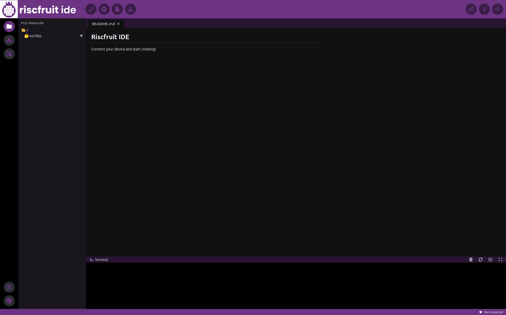
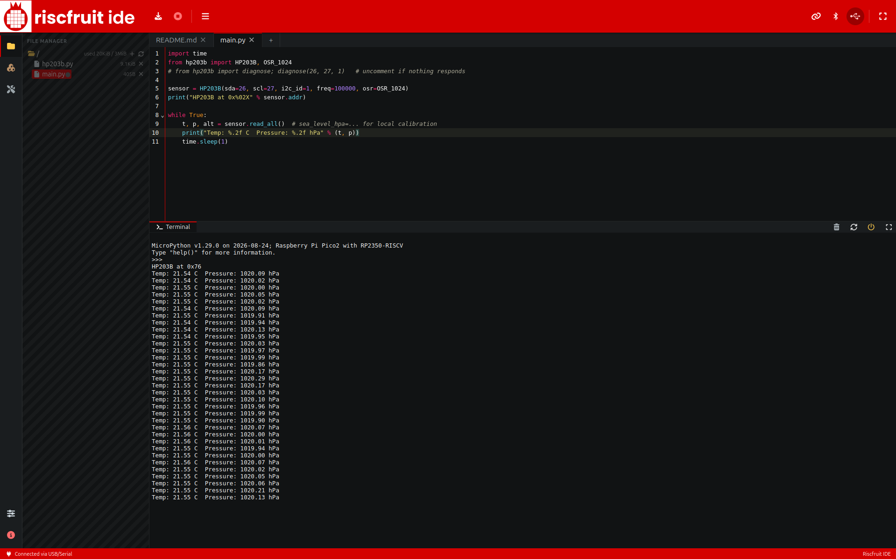

# Riscfruit IDE
A web-based IDE for programming Riscfruit embedded boards running Micropython, based on [ViperIDE](https://github.com/vshymanskyy/ViperIDE).

### Gallery

### Licensing
Copyright (c) 2026, Riscfruit Laboratory. This software is developed and distributed with [AGPL 3.0](LICENSE).
